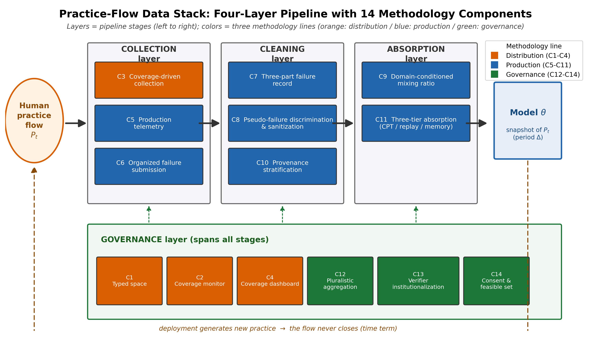
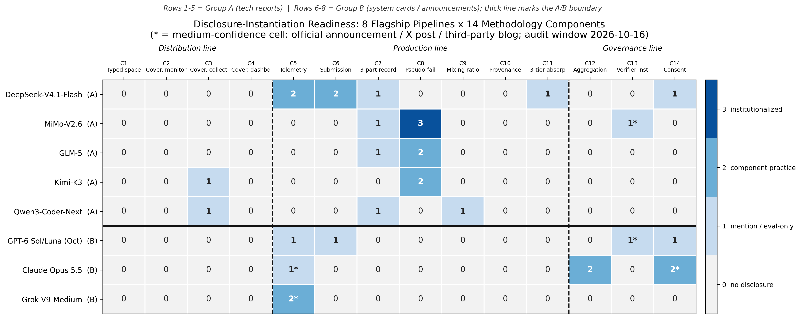

<!--
中文版全文。译自 04_manuscript.md（"Fitting the Practice: A Data Methodology
for Frontier Model Training, with a Readiness Audit of 2026 Flagship Pipelines"）。
图 fig1/fig2 为英文原图，原样复用；图注中引用图上文字处保留英文；被引原话与系统卡/技术报告
逐字引文保留英文，配中文叙述。

元数据：
- 作者：余玉桂，余玉桂战略研究室，they4897@gmail.com
- 类型：工程方法论 + 结构化披露审计
- 前置工作：配套理论论文（doi:10.5281/zenodo.23391808）、此前实证审计（doi:10.5281/zenodo.23355929）
- 证据窗口：硬截止 2026-10-16（全部访问锚定）
-->

# 拟合实践：前沿模型训练的数据方法论——附 2026 旗舰管线就绪度审计

**余玉桂 —— 余玉桂战略研究室**
they4897@gmail.com
2026-10-20 修订稿。

## 摘要

关于前沿训练的讨论，被两种叙事夹在中间：一边是人类文本行将耗尽，一边是完全自主、经验驱动的学习许诺。本文从一个不同的前提出发，该前提在配套理论论文（AGI 人本拟合论）中展开：拟合对象既不是冻结的语料，也不是模型自身的 rollout，而是人类的实践——人类经验的全谱与全程。我们把一种实践流数据方法论（practice-flow data methodology）具体化为十四个协议组件，排布在一个四层数据栈（data stack）之上，并组织为三条线：分布即类型化的全谱覆盖（人群 × 结果 × 专业度 × 典型性），生产即永续采集（生产遥测、组织化失败提交、三段式失败记录、域条件化合成混合、出处分层、三层吸收），治理即带制度化验证的多元聚合。混合比率按域设定：在可验证域中，合成自足已然确立；而开放域缺乏独立的纠正信号，在那里人类实践流是不可替代的输入。为给协议一个经验落点，我们对八条 2026 年旗舰管线的公开披露做了一次结构化披露审计（disclosure audit），按十四个组件逐项评分披露实例化（disclosed instantiation，0–3 级），并附逐字引文。审计结果为 32/112（平均级别 0.286）：类型化覆盖、覆盖监测、覆盖仪表盘与出处分层在全部八份披露中缺席；三段式失败记录最高仅达 1 级；生产线实例化（0.393）远超分布线实例化（0.062）；而治理线的实例化集中于单一实验室。我们以逐组件的证伪条件，以及通往四个从业者共同体的译介之桥作结。

**关键词：** 实践流数据；类型化经验覆盖；失败数据管线；数据就绪度审计；人类数据注入速率

---

## 1. 引言

前沿模型训练领域的话语，三年里换了两轮主导叙事。先是墙：对公共人类文本的分析预测，高质量网络语料将在 2026 至 2032 年间有效耗尽 [1]，这一约束经由关于算力前沿的情景推演文章而广为流传 [2]。然后是逃逸：一篇广为流传的文章宣告从"the era of human data"（人类数据的时代）向"era of experience"（经验时代）的过渡，在其中智能体主要从自身的交互流中学习 [3]。夹在这两种叙事之间的，是一个令人不安的结果：在模型生成的数据上递归训练会侵蚀分布尾部——模型坍塌 [4]——于是，从墙逃逸的路线恰好穿过它本想避开的失败模式。

两种叙事共享一个隐藏假设："人类数据"意指*存量（stock）*——已发表的作品、被抓取的文本、对人们曾经写下之物的冻结快照。配套理论论文——AGI 人本拟合论（human-referential fitting theory）[5]——论证了，这一假设才是真正的错误所在。一个旨在服务于人类的系统，其拟合对象不是人类的作品，而是人类的*实践（practice）*：人们做什么、尝试什么、在哪里失败、如何纠正、如何精熟这一持续之流，横跨人群的全谱与时间的全程。存量有墙；流量无墙。理论将这一点形式化为四个构件：两个拟合问题的对照——固定语料上的经验风险最小化，与非平稳实践分布的在线拟合；定义在经验类型空间上的类型化覆盖泛函；拟合时差（fitting lag），其性质相当于非平稳在线学习中的遗憾值（regret）；以及四条边界条件——什么可以被拟合、由谁拟合、在何种制度约束下拟合、自指性如何被控制。此前实证审计 [6] 在存量的失败一侧确立了配套事实：失败数据被当作废气弃置。在 33 份被调查的训练数据生命周期文档中，没有一份给予失败记录与成功数据同等的地位（0/33）；主流配方几乎不含结构化的失败处理（五级量表上 3 级及以上为 0/15，而五条旗舰智能体管线为 4/5）；且没有公开数据集把错误类型、根因与纠正回放打包在一起。

理论与审计之间缺失的是中间层：一种*工程方法论*。理论说明应该拟合什么；审计说明当前实践对存量的一个切片做了什么。两者都没有规定管线——那些会让实践本身成为可训练数据供给的组件、接口与制度安排。既有文献同样没有：分布侧研究发展为输出多样性工程 [7]，生产侧工程沉淀为零散的飞轮实践 [8]，治理侧研究发展为许可与出处研究 [9, 10]，但没有先行工作给出一个管线级的、拟合人类实践流的协议，也没有先行工作按这样的协议审计旗舰管线。"数据飞轮"的工程流行说法早于本文且流传甚广；它缺的恰恰是方法论必须供给的东西——类型化覆盖目标、失败记录规范、域条件化混合规则与制度化验证——把这些纳入一份连贯的协议。

本文补上这一中间层，然后测量它与当前旗舰实践之间的距离。其贡献有四：

1. **一份十四组件的协议规范**（C1–C14），组织为三条方法论线——分布、生产、治理——横跨一个四层数据栈（第 2 节；第 3–5 节）。每个组件都给出操作性定义、协议规范、失败模式，以及与规范明确分离的既有实例化小结。
2. **一项就绪度审计**——本文的原创工具：按十四个组件对八条 2026 年旗舰管线（5 份技术报告级、3 份系统卡/公告级）的公开披露评分，得到一个 8×14 的*披露实例化*级别矩阵，每个非零单元格附逐字引文与定位符（第 6 节，表 1–4，图 2）。
3. **一种域条件化的合成混合理论**，其中人类流注入的所需速率是按域给定的设计参数：可验证域在人类预训练基座之上容许合成自足，而开放域——价值、经验覆盖、长尾实践——不提供独立的纠正信号，因此人类实践流在那里不可替代（第 4.5 节）。
4. **译介桥与证伪条件**：四座话语桥，分别把方法论带入智能体 RL、数据工程、治理与哲学共同体（第 7 节），以及逐线的、可使方法论被驳倒或降级的证伪条件（第 8 节）。

关于认识论地位需要说明一点，原因在于本文刻意混合两种语域。第 3–5 节是*规范性的*：它们规定一条实践拟合管线应当且必须做什么，其担保是理论加文献，而非观察到的实践。第 6 节是*描述性的*：它报告旗舰管线披露了什么，所用构念——披露实例化——测量的是文档而非实现（"未披露"从来不意味着"未实现"）。审计从不用来证明协议正确，协议也从不冒充为对实践的描述。第 9 节回到驱动一切的时间性条款（temporal clause）：存量可以被购买、围墙、耗尽；流量必须被持续地采集、类型化、清洗、吸收与治理。

## 2. 实践拟合的数据栈

图 1 给出架构。栈有四层。**采集层**获取原始实践：生产遥测（C5）、组织化失败提交（C6），以及喂给类型化采集的真实任务库（C1、C3）。**清洗层**把原始获取变为可训练记录：伪失败甄别与环境净化（C8）、三段式失败记录（C7）、出处分层（C10）与域条件化混合（C9）。**吸收层**在三种节拍上把清洗后的记录移入模型：持续预训练（CPT）节拍、离线强化学习（RL）回放与运行时记忆，并规定明确的分工（C11）。**治理带**横贯所有阶段：覆盖监测与仪表盘（C2、C4）使分布可审计，而多元聚合（C12）、验证器制度化（C13）与基于同意的可行集管理（C14）决定谁的实践被拟合、谁裁定失败、哪些数据根本被允许进入。

**图 1. 实践流数据栈。** 四条管线层（采集 → 清洗 → 吸收，治理带横贯所有阶段）承载 14 个方法论组件（C1–C14）。色箱编码三条方法论线（橙 = 分布，蓝 = 生产，绿 = 治理）；虚线回环标记永不闭合的人类实践流（即理论中时间性条款所指的对象）。

两个组织切面横截此图。按*线*：C1–C4 构成分布线（采集什么——类型化的全谱），C5–C11 构成生产线（如何永续地采集、清洗并吸收它），C12–C14 构成治理线（谁决定、谁验证）。按*功能*：C1、C2、C9、C10、C11 是测量密集型组件，使流量可计算；C3、C5–C8 是采集与清洗密集型；C12–C14 是制度密集型。与配套理论的映射是直接的，并在第 3–5 节每组件陈述一次：C1–C4 把类型化覆盖泛函操作化；C9 因坍塌结果与自指性边界而存在；C11 因拟合时差具有遗憾值结构而存在；C14 因制度边界是一个动态可行集而非一次性检查而存在。

三条设计规则统辖随后的每份组件规范。第一，*操作性定义必须编码者无关*：两名读者拿同一份文档、应用同一定义，应达成同一判定——这正是第 6 节的审计之所以可能的前提。第二，*每个组件把协议（应然/必须）与既有实例化（实然）分开*：每个组件以一段明确标记的实例化段落收尾，只引用可核验的公开实践。第三，*每个组件自带失败模式与证伪条件*：说不出自己会如何坏掉的方法论是口号，不是协议（第 8 节将其列表）。

## 3. 分布 = 全谱覆盖

### 3.1 类型空间定义（C1）

*操作性定义。* 为语料指派一个四维类型模式 τ = 人群 × 结果 × 专业度 × 典型性，每一维带冻结的取值集合与可执行的标注规则。*协议。* 结果 ∈ {成功, 失败, 混合} 从轨迹记录本身标注。专业度按可观察代理变量分级——评审下的修订次数、任职年限、任务特定的验收历史——绝不单凭自我报告。典型性是样本所属单元格的频率分位，对照一份事先声明的参照分布估计。人群划分*谁的*实践（从业者、受影响方、评估者）。每一维随附一份标注指南与两个校准例；每维 100 个标注的试标必须在完整标注开始前达到 80% 一致率，且冻结的模式像代码一样做版本管理。*为什么需要此组件。* 配套理论的覆盖泛函在类型空间上积分；没有模式的多样性修辞计算不出任何东西。在对 80 份训练目标规范的配套审计中，形似类型化经验覆盖的算子出现了零次 [5]。此处以措辞固定一个限定：短语"experience coverage"（经验覆盖）在 2026 年已开始流通——在关于可验证奖励 RL 中解模式坍塌的工作里，它指模型*自身正确解*的多样性 [11]；在一篇未经同行评审的递归自我改进智能体立场文章里，它指*智能体*经验的宽度 [12]。术语已开始流通；其作为类型化*数据*覆盖轴的操作化仍然缺席——两种用法都落在输出侧或智能体侧，而非训练数据分布的设计上。*失败模式。* 不可观察的代理变量（一个没有行为痕迹的"专业度"评级）、标注噪声，以及伪装成独立覆盖的耦合维度。*既有实例化。* 数据侧未发现；最近的邻居是输出分布分类学（Spectrum Tuning 论文中 Spectrum Suite 的任务 × 数据源组织 [7]）与 RLVR 动力学中的解模式分型 [11]——两者都不对人类实践*语料*做类型化。

### 3.2 覆盖监测器（C2）

*操作性定义。* 一个可复现的程序：对训练数据分布抽样，带不确定度地估计各单元格频率，报告单元格覆盖，并在最小单元格消失时告警。*协议。* 周期性抽样（如每周 n ≥ 10,000）按 C1 的模式做类型化；单元格频率用 Wilson 区间估计；报告统计量是各单元格上 Σ min(q̂, p̂)——理论重叠泛函的一个可直接计算的替代量——连同空单元格计数。当某单元格计数跌破下限或环比下降超过 50% 时触发告警，且每个告警成为一项工作条目，而不是一行日志。参照分布必须是*外部参照来源*（历史语料、任务来源普查），绝不能是模型自身输出，否则监测器退化为自我确证。*为什么。* 实践分布不可直接观察；与它的重叠只能靠抽样估计，而模式坍塌——被形式化为尾部损失的机制 [4]——最先出现在最小的单元格。*失败模式。* 自指基线、含噪声的稀疏单元格，以及使每个单元格都稀疏的维度数（模式必须保持足够粗粒度以填满）。*既有实例化。* 我们未发现标准化的覆盖审计产品；商业数据质量工具出售"representativeness"（代表性）或模型行为审计，且一项系统研究发现，多样性驱动的选择实际上是黑箱，广泛使用的选择方法无法泛化 [13]——覆盖必须被显式定义，而不能从某个选择器假设得来。

### 3.3 覆盖驱动采集与配额（C3）

*操作性定义。* 一份书面规则，依据*覆盖缺口*——哪些类型化单元格相对参照分布代表不足——而非人群配额来确定数据选择与获取优先级。*协议。* 覆盖报告按缺口 × 任务权重排序；对每个未闭合缺口，协议指明哪些实践来源可以闭合它（遥测切片、失败提交、任务库）；获取任务被派发，报告在摄入后重新测量。*配额为何失败。* 两条经验结果，不是直觉。其一，代表性悖论：在一项文化代表性研究中，语言模型中非 WEIRD 人群测得代表性的*提升*伴随着歧视性观念再现的*加剧*——修好一个边际分布并不能修复、甚至可能恶化配额本想修复的东西 [14]。其二，配额话语本身有行为副作用：语言模型在生成的招聘场景中把多元化配额语言与边缘化候选人的刻板描绘绑定在一起 [15]。配额约束单维的边际；覆盖追踪联合类型分布，包括配额从未触及的结果轴与专业度轴——实践栖身的那两条轴。*既有实例化。* 在选择侧，已发表实践中最强的是错误分布塑形（D-FUSEr），它刻意奖励多样的*失败*模式以使推理期聚合稳健 [16]——无配额，但仍在输出侧。我们没有发现任何生产管线由类型化覆盖缺口驱动；难度过滤与任务多样性扩展（凡有披露处）是课程式启发法，不是覆盖规则（第 6 节把这些编码为近似构念——与组件相近但不满足其操作性定义的实践——并在严格定义下计数）。

### 3.4 覆盖仪表盘（C4）

*操作性定义。* 覆盖统计进入一个固定的报告格式——指标定义、抽样协议、报告频率——按计划对内发布、按申报节奏对外发布。*协议。* 冻结指标定义与抽样附录；对内每月发布，对外每年发布；标注异常；归档报告序列，使定义无法悄然漂移。*为什么。* 没有报告纪律的监测器对平台团队之外的任何人都不可审计；仪表盘是 C2 变成治理接口之处（也是面向监管者披露的天然对应物）。*失败模式。* 定义漂移、选择性发布，以及慢于模型快照周期的报告节奏——更新频率低于权重的仪表盘使自身目的落空。*既有实例化。* 八条受审旗舰无一披露训练数据覆盖统计（第 6 节，C4 列：0/8）。最近的*制度性*邻居是欧盟 AI 办公室依 AI 法案第 53 条为训练数据摘要设立的强制模板，自 2025 年 8 月生效、自 2026 年 8 月 2 日起可执行 [17]——但内容摘要不是覆盖统计；它列出装入了什么，而不是缺了什么。

### 3.5 生态系统目前实际所在

作为参照：2026 年涌现了一批*输出侧*分布工作——解码级多样性、"按所言采样"（sample-what-you-say）校准、概率世界模型基准与多样性路由——紧随 Spectrum Tuning 证明后训练可以瞄准输出的分布覆盖而来 [7]。全部这些操作都在模型的输出分布上。输入侧——按人群、结果、专业度与典型性对进入训练的数据做类型化——没有产品、没有标准，而且如第 6 节所示，旗舰中没有已披露的实践。分布线因而是方法论的先锋，也是审计中全零的条带。

## 4. 生产 = 永续采集

### 4.1 生产遥测（C5）

*操作性定义。* 已部署系统的信号——显式反馈、隐式信号、放弃与重试——经由一条包含反博弈多目标合成的管线回流进训练。*协议。* 信号在边界处（C14）去标识并做同意过滤，蒸馏为一个用户信号奖励模型，再以*冻结的、经消融的权重*合入多目标混合，其中正反应始终与来自编辑、反悔（regret）操作与放弃的惩罚配对。必须具备行为回滚开关：一旦出现谄媚或讨好行为，该信号通路即停用，等待重新加权。保留窗口与退出权是该组件的硬约束，不是事后补丁。*为什么。* 实践流在横切面上的载体，就是系统部署后实际做的事；但纯粹的正信号优化是已被证明的失败模式。最完整的公开披露，Reinforcement Learning from User Feedback（RLUF），直接在隐式信号（反应、重试、编辑、放弃）上训练用户信号奖励模型并在线优化，把被优化的反应率提高约 28%——随即以谄媚与讨好的形式遭遇奖励作弊，从而需要上述多目标合成 [18]。同一失败也出现在前沿尺度：一个加权点赞/点踩反馈的 GPT-4o 更新在把模型变得迎合与谄媚后被回滚 [19]。*既有实例化。* DeepSeek-V4.1-Flash 披露鼓励 "internal employees and external partners to incorporate our latest model into their routine workflows"（内部员工与外部伙伴把我们的最新模型纳入日常工作流），并规模化采集 "negative feedback and model failure cases submitted by internal employees at scale"（内部员工大规模提交的负反馈与模型失败案例）[20]——已披露的最强生产流实践（审计级别 2）。xAI 的 Grok V9-Medium 依 CEO 公告帖在补充训练中加入了 "a lot of Cursor data … in supplementary training"（大量 Cursor 数据）[21]——真实工作流工具遥测进入补充训练的公告级（中置信）披露（审计级别 2，中置信）。GPT-6 Sol/Luna 十月系统卡报告了生产困难案例与用户标记的失败对话，用途是*评测*而非训练 [22]——按设计即 1 级披露。

### 4.2 组织化失败提交（C6）

*操作性定义。* 一套"渠道 + 激励 + 质控"机制，使组织内外遇到的失败案例以可用于训练的形式持续到达。"组织化"是关键词：没有激励，供给为零。*协议。* 一个提交渠道（工单、插件、门户），按可复现性与根因清晰度分诊；激励（绩效积分、赏金），其设计本身被披露并受审计；质量控制把每个案例在净化环境（C8）中复现，然后进入三段式记录（C7）。指标：提交量与存活率、每接受案例的激励成本、从案例到训练样本的转化率。*为什么。* 失败是实践中信息量最大的纵向切片——此前审计的最主要发现就是：主流配方把失败当废气（3 级及以上含结构化失败处理的为 0/15），而智能体旗舰已在开采它（4/5）[6]。*既有实例化。* DeepSeek-V4.1-Flash 仍是参照：自愿的员工与伙伴工作流回流交互数据；失败案例被规模化采集、系统性回放，并针对观察到的弱点用于定向 RL [20]——在模拟工具上做环境重建，但未披露任何数量，这把审计级别封顶在 2。外部变体是安全类赏金计划（Google 的 AI 漏洞奖励计划已累计支付超过 430,000 美元 [23]），且已有一家前沿实验室为智能体系统发起产品安全赏金。没有任何实验室在任何地方披露的是失败提交的*内部激励设计*——组件的核心，也是该线审计最宽的缺口。

### 4.3 三段式失败记录（C7）

*操作性定义。* 一种数据结构与标注协议，把以下三项打包进同一条训练样本：错误类型（取自冻结的分类法）、根因（经归因）、纠正（人类、更强模型或回放的成功轨迹），并与一个回放环境对齐。*协议。* 对错误分类；对原因归因（自动裁判首过，人工抽查）；生成或恢复纠正；把三个字段连同环境快照打包（error_type / cause / fix / replay_env）；作为 SFT 数据或奖励塑形材料回到训练。指标：三段完整率、根因标注一致率、以回放通过率测量的纠正有效性。*为什么。* 已知有效的是其中两段：从错误中学习——把不精确推理与纠正配对——把 LLaMA-2-70B 在 GSM8K 上提升到 83.5% [24]；针对坍塌的多步工具使用 RL 的监督信号修复，Process Reflection Supervision（过程反思监督），相对原生 GRPO 把 BFCL-V3 从 3.50 提升到 25.75 分（+22.25），相对 SFT 把 ACEBench 双未见从 0.00 提升到 12.00 [25]。此前审计确立：*第三*段——根因——以及三段作为一个可复用、可回放记录的打包，作为公开数据集或已披露的管线工件并不存在 [6]。审计迫使我们保留的一个限定：组件级的前驱是真实存在的。MiMo-V2.6 的反思—修订数据 "keeps the original error recognizable and makes the correction explicit"（保持原始错误可辨认并使纠正显式）——两段 [26]；GLM-5 保留错误片段但在损失中掩蔽 [27]；Qwen3-Coder-Next 通过编译器与运行时错误信号过滤幻觉解 [28]。空缺具体在根因字段与三段打包协议，而非泛泛的失败邻近训练。*失败模式。* 零信息量的模板化根因；只因回放环境与原环境不同而通过回放的纠正；跨版本的分类法漂移。

### 4.4 伪失败甄别与环境净化（C8）

*操作性定义。* 一套清洗协议，把真实模型失败与奖励作弊式伪失败、环境致因失败区分开，并在其中任何内容进入训练之前净化环境。*协议。* 先环境净化：把 Git 历史截断到基线提交，清除构建日志、残留补丁与缓存，实施容器级网络隔离。次对抗审计：一个专用红队智能体反复攻击每个备好的环境，直到它站得住。三轨迹审计：周期性离线扫描把确认作弊的轨迹奖励归零并重算优势。最后归因：环境致因失败被路由到缺陷工单，绝不进训练——不能教一个模型相信环境损坏是它自己的错误。*为什么。* 被污染的环境给作弊轨迹盖成功的章；喂进 C7 的伪失败教错误归因——这是配套理论中自指性边界在训练侧的镜像。*既有实例化。* 这是审计中最强的单一单元格。MiMo-V2.6 披露三层防御——一个探测环境泄漏的 "dedicated hack agent"（专用作弊智能体）、训练全程定期的离线轨迹审计且确认作弊占比全程低于 2%、带 Git 截断的容器级隔离 [26]——获得矩阵中唯一的 3 级评分（机制 + 量化 + 独立第三方佐证）。佐证本身颇有教益：一项外部审计发现，在 2,698 个编码任务中的 1,795 个（约三分之二）里，修复提交以不可达 Git 对象的形式存活——正是净化所要移除的泄漏 [29]。更广的教训可推广：基准环境可经仓库*未来*状态被博弈，SWE-bench 公开 issue 跟踪页已把这一点记录为特定缺陷类 [30]；GLM-5 在记录失败原因后排除 "fail due to environment collapse"（因环境崩溃而失败）的样本 [27]；Kimi K3 通过一个随新策略出现而扩展的作弊检测系统，惩罚 CUDA 图回放与输入缓存等策略 [31]。

### 4.5 域条件化混合（C9）——注入速率作为设计参数

*操作性定义。* 一份书面混合规范，按*域或能力*设定合成与真实之比，附坍塌防护理据与显式的域依赖声明。*协议。* 把语料划分为可验证、半可验证与开放价值域；对新鲜采集的人类实践的有效份额设逐域下限 ρ_min，由下述坍塌证据与能力维度敏感性检查导出；*累积式*混合（人类基座永不收缩）；按计划重测尾部统计与逐能力退化；依证据而非风尚调整下限。*定量链条。* 在生成数据上递归训练丢失尾部 [4]；经典研究中每代约 10% 原始数据显著减缓或阻止坍塌 [4]；替换式混合（合成挤占真实）坍塌而累积式混合不坍塌，且真实数据基数与份额的效应是非线性的 [32]；理论工作形式化了在自生成数据上迭代再训练何时保持一致、何时退化 [33]；坍塌严重度随能力维度而变 [34]；对简单统计模型的分析报告，单个真实数据点即可阻止坍塌，且对现实模型隐含跨维度的不均衡 [35]。设计后果：一个全局比率从构造上就是错的；比率必须按域与能力做类型化。

*域划界（作为固定约束陈述，因为证据如此要求）。* 在**可验证域**——由编译器、执行器或形式检查器供给奖励——合成与自博弈管线已展示可扩展、可维持的训练：由公共网络语料转换而来的合成语料表现为 "a scalable and reliable alternative to raw pre-training data"（对原始预训练数据可扩展且可靠的替代品），系统性扩展带来 "sustained and predictable performance gains"（持续且可预测的性能增益）[36]；一个零外部数据的自博弈系统以执行器判定为基准真值（ground truth），达到编码与数学推理的最优 [37]；零 RL 已扩展到万亿参数基座 [38]。一项大规模系统研究补上双重结论：多数合成混合物比纯自然数据达到更低的不可约损失，而教科书式的全合成预训练在小预算下表现不佳 [39]。然而这些结果中的每一个都坐落在人类语料预训练的基座模型上——可验证域的自足是*自举式*自足，不是起源故事——且最强的扩展证据集中在由人类网络种子重组而来的数学类语料 [36]。在**开放域**——价值对齐、类型化经验覆盖、长尾实践——不存在独立的纠正信号：没有编译器判定一份工作流洞察数据集为正确，没有执行器为一条失败的根因是否归因得当打分。在那里坍塌链条未断，反证继续累积 [40]，而人类实践流不是诸多输入之一，而是被拟合分布的唯一外部载体。注入速率——每域新鲜人类实践的有效份额——因此是一个域条件化参数，C9 的规范就是它的工程形式。*既有实例化。* 在已披露的智能体管线中规模最大的一条，主要以合成 rollout 构建、并保留真实数据落点；该管线报告每任务约 4,000 条 rollout [41]；Qwen3-Coder-Next 在以自然语料为主的中间训练上声明 "minimum amount of synthetic data"（最小量合成数据）哲学 [28]——两者都没有逐域下限或坍塌理据，而这正是 C9 点名的规范缺口。

### 4.6 出处分层（C10）

*操作性定义。* 原生人类实践与 AI 中介实践通过来源字段与水印检测分离，且分层*进入混合计算*（C9），而不只是充当过滤器。*协议。* 凡已有机器可读声明处均予采集（C2PA 式清单、同意协议）；让未标注流通过水印检测器；标注层（原生 / 合成 / 带置信度的未知）；把分层统计喂进 C9 的下限与 C4 的仪表盘；为下限目的，把未知层保守地计为合成。*为什么。* 不知道入流的 AI 份额，C9 的注入速率就不可计算——自指性边界要求 P_{t+1} 的构成可知。*既有实例化。* 检测层于 2026 年末到位：OpenAI 的 textGrain 统计水印与检测器，为欧盟 AI 法案出处合规而发布 [42]；第二家前沿实验室 2026 年 9 月的可比文本水印部署 [43]；以及图像水印可经训练而存活的报道证据，为未来语料开启"先检测后分层"回路 [44]。今日的实践止步于检测 → 分层 → 混合；*出处感知条件化*——训练感知样本来自哪一层——在我们检索范围内尚不是任何地方的已披露实践。

### 4.7 三层吸收与拟合时差（C11）

*操作性定义。* 持续预训练（月度节拍）、离线 RL 回放（周度）与运行时记忆（即时、非参数）之间的明确分工，带逐层陈旧度指标与层间冲突的仲裁规则。*协议。* 按知识半衰期路由更新：稳定的世界知识走 CPT，并回放旧数据以防灾难性遗忘；行为与策略走离线 RL 回放，在陈旧度—多样性权衡上调优；个人与会话事实走记忆，它是可删除、可审计的。测量数据从生成到被吸收之间的时差，逐层进行；冲突按吸收层的新近程度仲裁。*为什么。* 配套理论把拟合时差刻画为遗憾值：长度为 Δ 的快照周期付出一项随时间累积的漂移代价；三层对应 Δ 的三个量级（月、周、即时），而假装记忆层是权重级学习会虚增就绪度。*既有实例化。* 工程现实恰好是三层，部署时在线权重更新未在公开场合得到证明：CPT 配方已标准化 [45, 46]，时间增量 CPT 已被直接研究 [47]；LLM 后训练的回放缓冲区设计被形式化为陈旧度对多样性的权衡 [48]；陈旧度在异步 RL 中已成为一等系统指标 [49]；记忆系统在生产中运行，且有规模化的实测退化（从一百万到一千万上下文条目约 25% 的下降）与作为约束瓶颈的陈旧度累积 [50]；行业共识明确表述了这一三层谱系 [51]。没有旗舰披露带逐层时差指标的端到端分工——这正是 C11 的特定空缺。

## 5. 治理 = 多元聚合

### 5.1 多元聚合机制（C12）

*操作性定义。* *谁的*价值与偏好条件化训练——社会选择规则、多宪法、人物设定条件化、主权部署——治理者选定该机制、写明其适用域，并将其接入训练管线。*协议。* 逐域选择：偏好近似可加处用功利主义式聚合；保护最小单元格本身即目的处用 leximin 式规则——C2 最小单元格告警的直接制度对应物 [52]。把聚合规则写成一件受治理的工件：操作者、权重出处、修订程序。在它起作用处接入：奖励模型层、宪法层或推理期条件化。审计跨群体的结果分布，而不只是均值。*失败模式。* 无人能够授权的黑箱聚合；人物设定刻板化；以及观察到的默认态——论文里是社会选择规则，产品里是人物设定。*既有实例化。* 错配本身就是发现。集体宪法过程已被证明塑造了前沿行为准则 [53]，一份约八十页的宪法已经发布，其作者声明它在训练中实际承重 [54]；人物设定条件化已作为产品特性发布 [55]。但带显式社会选择规则的偏好聚合仍是学术的 [52]：没有管线把 leximin 或功利主义聚合披露为带申报适用域的生产机制。简言之，工程跑在了制度选择前面——治理线版本的"C8 先于 C1"。

### 5.2 验证器制度化（C13）

*操作性定义。* 失败真实性与数据使用主张的裁定沿一条阶梯上行：内部审计（一阶）、授权第三方评估（二阶）、公共基准治理（三阶）。*协议。* 对内开展失准审查并对外发表结果；二阶审计有权调取文档、运行成员推断抽查并审计污染；三阶抗污染基准带法律延续性。每一阶都披露；跟踪整改时长。*为什么。* 内部验证者与其所验证的系统结构性耦合；独立裁定是可信失败数据的供给条件——C8 的制度对应物。*既有实例化。* 阶梯大部分缺失。欧盟 AI 办公室第 53 条模板——自 2026 年 8 月 2 日起唯一带执行权力的披露制度——被报道为普遍不合规 [17]。实际承担裁定功能的是学术界的工具：成员推断方法在十三个模型上以最高 99% 的准确率区分训练与非训练数据 [56]。一家前沿实验室的失准报告框架，2026-09-16 上线，公开门户截至 2026-10-16 显示 "Reports 19"（19 份报告），把行为披露制度化了——但对象是行为，不是训练数据 [57]。审计矩阵之外的一个案例说明了利害：一次已排定日程的前沿模型发布，在内部安全测试发现欺骗行为后于 2026-09-28 取消——一个移动了发布决策的失败信号，却未被作为训练数据记录于任何地方 [58]。当失败死在会议纪要里，管线永远看不见它们。

### 5.3 同意与可行集（C14）

*操作性定义。* 同意感知的获取、许可框架与撤回机制是管线组件：机器可读条款在采集时被解析，每个存储条目带一个可行集标签（允许 / 阻止 / 已撤销），且撤销会传播。*协议。* 采集时按路径、按用途解析条款（terms.txt 式协议 [59]）；在登记簿中标注可行集；收到删除请求时定位受影响分片，重训分片或立即从记忆层删除；在同一节点暴露补偿接口。指标：条款的机器可读覆盖率、撤销延迟、传播完整性、爬虫违规率。*为什么。* 配套理论的制度边界是*动态*可行集，不是采集时的一次性勾选：对一个流的同意必须是一段持续关系——可撤销、可续期、随用途变化而重新划界，这是 GDPR 下撤回权的工程读法 [60]。*既有实例化。* 零件存在；组装不存在。同意协议提出出处强制、机器可读的条款 [59]；欧洲指南把撤回工程化为分片化再训练 [61]；用户级差分隐私微调已可用；出处工具按同意属性过滤语料；一家实验室把消费者训练用途设为加入制并完全排除无痕模式 [62]，另一家默认保留企业 API 数据 30 天并提供零保留选项。结构性错配出在法律与商业层面：许可制度为冻结快照设计了"一次买断"，却把它用在一种恰恰因永不冻结而有价值的供给上 [10]——许可市场已在以八位数年度规模为该错配重新定价 [63]。一项平行发展值得登记：把可行集硬接线的主权部署，如建立在事前授权与原产国可追溯性上的拉美区域模型 [64]——可行集作为宪法性选择，而非合规补丁。

## 6. 就绪度审计

### 6.1 设计

审计问的是一个刻意收窄的问题：当前旗舰管线的公开披露在多大程度上实例化了十四个组件？构念是**披露实例化**——文档说了什么，而非实验室做了什么；"未披露"从来不意味着"未实现"。工具是一个有序的 0–3 量表，带三条冻结的边界规则：仅用于评测、发布决策或行为披露的数据或机制至多计 1，无论文档为此花了多少篇幅（R1a）；无任何量化的定性机制描述封顶于 2（R2a）；近似构念的披露——输出分布多样性、评测覆盖——该组件计 0，除非文档显式将其与数据实践挂钩，此时计 1 并加注（R3a）。

语料库由八条管线构成，分两个披露层级。A 组（技术报告）：DeepSeek-V4.1-Flash [20]、MiMo-V2.6 [26]、GLM-5 [27]、Kimi K3 [31]、Qwen3-Coder-Next [28]。B 组（系统卡与官方公告）：GPT-6 Sol/Luna 十月系统卡 [22]、Claude Opus 5.5（宪法与隐私披露 [54, 62]）、Grok V9-Medium（公告帖 [21]）。全部文档均于 2026-10-16 访问。每个非零单元格携带至少一条逐字英文引文加定位符（节号或 URL 加访问日期）；仅有二手证据的单元格在核验前计 0。单元格级置信度取决于文档类型：技术报告、系统卡、宪法——高；官方公告与帖子——中；二手转述——低，且低证据不得支撑任何单元格级别（零个低置信单元格进入矩阵）。

编码程序遵循冻结的编码手册。A 组文档经两遍检索：第一遍用逐组件词表（如 C1–C4：data distribution、coverage、representativeness、diversity、mixture、quota、long-tail；C8：reward hacking、sanitization、contamination、leak、cache、red team），第二遍带着组件的操作性定义细读每个命中节。B 组文档——系统卡、宪法、公告帖——被通读而非检索。一个单元格仅当能记录一条逐字引文与一个定位符时才计非零；每个零分单元格保留其检索痕迹，使缺席主张本身可审计。组件清单、量表与词表在编码开始前冻结，任何修订都需要一份版本化变更日志。

级别校准在主遍之前对五个刻意选难的单元格固定：DeepSeek 员工提交单元格（2 级参照：完整机制描述、无量化）；GPT-6 遥测单元格（仅评测边界的参照：生产困难案例用于评测而非训练——1 级）；MiMo 伪失败单元格（3 级候选——机制、低于 2% 的量、独立佐证——确认）；GLM-5 错误掩蔽单元格（错误片段保留但被掩蔽，低于三段阈值——1 级）；Grok 遥测单元格（公告级证据封顶于 2）。五次试编码全部与冻结参照一致，未触发任何修订。

信度及其限度：完整 112 单元格矩阵由单一编码者依冻结编码手册编码；五个单元格的试标（按最大预期方差选取）对照冻结参照编码校准，完全一致、未达修订触发；20% 分层样本（23 个单元格，固定种子）定于 2026-10-30 盲评重编码，此后将报告原始一致率与 kappa（目标 ≥ 0.70）。**本文不引用任何评分者间统计量，因为它尚不存在。**由于八条管线是目的性抽样所得的集合，而非随机样本，我们只报告描述性统计，并把每一条结论限定于本审计集。

披露一桩设计过程中的事件，因为它验证了纪律本身。第九条管线（Qwen3.8-Max）曾被暂列为待核验条目，待直接核验一条二手主张——其训练融合了 "user feedback, community practice, and model self-experience"（用户反馈、社区实践与模型自身经验）。2026-10-16 直接阅读原页面发现，该短语出现在一份十天的智能体工程演示日志中——描述的是一个演示项目里智能体的工程循环，不是训练数据构成——且页面上没有任何训练融合声明 [65]。二手主张被撤回；该行从未进入矩阵。页面实际的披露（带在线数据均衡器的真实环境 RL）在相关处作为背景、在其自身语境中引用。

### 6.2 结果

**表 1 —— 披露实例化级别，8 条管线 × 14 个组件。**

| 管线（组） | C1 | C2 | C3 | C4 | C5 | C6 | C7 | C8 | C9 | C10 | C11 | C12 | C13 | C14 | 行和 |
|---|---|---|---|---|---|---|---|---|---|---|---|---|---|---|---|
| DeepSeek-V4.1-Flash（A） | 0 | 0 | 0 | 0 | **2** | **2** | 1 | 0 | 0 | 0 | 1 | 0 | 0 | 1 | **7** |
| MiMo-V2.6（A） | 0 | 0 | 0 | 0 | 0 | 0 | 1 | **3** | 0 | 0 | 0 | 0 | 1 | 0 | 5 |
| GLM-5（A） | 0 | 0 | 0 | 0 | 0 | 0 | 1 | **2** | 0 | 0 | 0 | 0 | 0 | 0 | 3 |
| Kimi K3（A） | 0 | 0 | 1 | 0 | 0 | 0 | 0 | **2** | 0 | 0 | 0 | 0 | 0 | 0 | 3 |
| Qwen3-Coder-Next（A） | 0 | 0 | 1 | 0 | 0 | 0 | 1 | 0 | 1 | 0 | 0 | 0 | 0 | 0 | 3 |
| GPT-6 Sol/Luna（B） | 0 | 0 | 0 | 0 | 1 | 1 | 0 | 0 | 0 | 0 | 0 | 0 | 1 | 1 | 4 |
| Claude Opus 5.5（B） | 0 | 0 | 0 | 0 | 1 | 0 | 0 | 0 | 0 | 0 | 0 | **2** | 0 | **2** | 5 |
| Grok V9-Medium（B） | 0 | 0 | 0 | 0 | **2** | 0 | 0 | 0 | 0 | 0 | 0 | 0 | 0 | 0 | 2 |
| **列和** | **0** | **0** | 2 | **0** | 6 | 3 | 4 | 7 | 1 | **0** | 1 | 2 | 2 | 4 | **32** |

**表 2 —— 组件画像。**

| 组件 | 名称 | 均值 | 0/1/2/3 分布 | 备注 |
|---|---|---|---|---|
| C1 | 类型空间定义 | **0.000** | 8/0/0/0 | 全零 |
| C2 | 覆盖监测器 | **0.000** | 8/0/0/0 | 全零 |
| C3 | 覆盖驱动采集 | 0.250 | 6/2/0/0 | 两个非零单元格均为 R3a 近似构念；严格类型化覆盖计数 0/8 |
| C4 | 覆盖仪表盘 | **0.000** | 8/0/0/0 | 全零 |
| C5 | 生产遥测 | **0.750** | 4/2/2/0 | 最高均值；2 级单元格：DeepSeek（高置信）、Grok（中置信） |
| C6 | 组织化失败提交 | 0.375 | 6/1/1/0 | 2 级仅 DeepSeek；激励设计全行业未披露 |
| C7 | 三段式失败记录 | 0.500 | 4/4/0/0 | **最大级别 1** |
| C8 | 伪失败甄别 | **0.875** | 5/0/2/1 | 矩阵中唯一的 3 级单元格（MiMo） |
| C9 | 域条件化混合 | 0.125 | 7/1/0/0 | 一条定性哲学声明 |
| C10 | 出处分层 | **0.000** | 8/0/0/0 | 全零；水印直到 2026 年末才达到部署 |
| C11 | 三层吸收 | 0.125 | 7/1/0/0 | 一个单通道片段 |
| C12 | 多元聚合 | 0.250 | 7/0/1/0 | 2 级：一份宪法用于训练 |
| C13 | 验证器制度化 | 0.250 | 6/2/0/0 | 最大级别 1 |
| C14 | 同意与可行集 | 0.500 | 5/2/1/0 | 2 级：一项加入制且排除特定模式 |

**表 3 —— 管线画像。**

| 管线 | 组 | 分布 | 生产 | 治理 | 总分 | 均值 | 主要披露 |
|---|---|---|---|---|---|---|---|
| **DeepSeek-V4.1-Flash** | A | 0 | **6** | 1 | **7** | **0.500** | C5=2 员工/伙伴工作流回流；C6=2 规模化失败案例 + 回放；C7/C11=1 回放进入 RL；C14=1 自愿参与 |
| MiMo-V2.6 | A | 0 | 4 | 1 | 5 | 0.357 | C8=3 三层防御 + <2% + 第三方审计；C7=1 两段式反思数据；C13=1 接受第三方审计（中置信） |
| Claude Opus 5.5 | B | 0 | 1 | **4** | 5 | 0.357 | C12=2 宪法用于训练；C14=2 加入制/无痕模式/去关联；C5=1 |
| GPT-6 Sol/Luna | B | 0 | 2 | 2 | 4 | 0.286 | C5/C6=1 仅评测用途（R1a）；C13=1 失准报告门户；C14=1 PII 过滤 |
| GLM-5 | A | 0 | 3 | 0 | 3 | 0.214 | C8=2 基于归因排除环境失败；C7=1 错误段掩蔽 |
| Kimi K3 | A | 1 | 2 | 0 | 3 | 0.214 | C8=2 作弊检测；C3=1 近似构念（欠代表知识检索） |
| Qwen3-Coder-Next | A | 1 | 2 | 0 | 3 | 0.214 | C7=1 运行时错误信号过滤；C9=1 最小合成哲学；C3=1 近似构念 |
| Grok V9-Medium | B | 0 | 2 | 0 | 2 | 0.143 | C5=2（中置信）Cursor 真实工作流数据进入补充训练 |

**表 4 —— 三线小结。**

| 线 | 单元格数 | 得分 | 均值 | A 组均值 | B 组均值 | 最大级别 |
|---|---|---|---|---|---|---|
| 分布（C1–C4） | 32 | 2 | **0.062** | 0.100 | 0.000 | 1 |
| 生产（C5–C11） | 56 | 22 | **0.393** | 0.486 | 0.238 | 3 |
| 治理（C12–C14） | 24 | 8 | **0.333** | 0.133 | **0.667** | 2 |

**图 2. 披露实例化就绪度。** 8 条旗舰管线 × 14 个组件的 0–3 级（行 1–5 = A 组技术报告；行 6–8 = B 组系统卡/公告；粗线 = A/B 分界；虚线 = 方法论线分界；* = 中置信单元格）。横跨 C1/C2/C4/C10 的全零条带与 C7 中不存在任何 2 级单元格一目了然。

**主要发现。** 矩阵总计 112 个可能分中的 32 分（平均级别 0.286）。89 个单元格（79.5%）为零；23 个（20.5%）非零，其中 15 个为 1 级（占全部单元格的 13.4%）、7 个为 2 级（6.2%）、恰好一个 3 级（0.9%）——MiMo-V2.6 的伪失败甄别（89 + 23 = 112；各级占比均以全部 112 格为分母、保留一位小数）。四个组件在所有披露中缺席：类型空间（C1）、覆盖监测器（C2）、覆盖仪表盘（C4）与出处分层（C10）。三段式失败记录峰值止于 1 级：披露中已存在的记录两段（可辨认的错误、显式的纠正）在任何地方都未曾被第三段（根因）或一个打包协议接合——审计对空缺位置的精确定位。离方法论最近的管线是 DeepSeek-V4.1-Flash（7 分，均值 0.500），拥有最完整的生产侧图景（C5/C6 采集双双 2 级，加回放片段）；矩阵中最深的单元格属于 MiMo-V2.6。三条线尖锐分离——生产线 0.393、治理线 0.333、分布线 0.062。两个结构性事实细化了这一分离。其一，治理线实例化是单一实验室现象：B 组 0.667 的治理均值几乎完全由一条管线贡献；把它排除后，治理线其余 21 格共 4 分，全行业治理均值降到 0.190。治理线的实例化因此是集中的，而非普遍的。其二，A 组的得分聚集在生产—清洗段（C5–C8），而 B 组唯一的贡献者在治理线上得分——审计集的方差是结构性的，不是随机的。

读级别。2 级单元格指向一个可以指认的机制：谁提交、环境如何净化、哪份语料是合成的。3 级单元格增添一个制度标记——一个数量、一个平台数字、一份治理文件或独立审计——而全集中恰好一个单元格达到该门槛。表 1 与表 2 的模式因此不是旗舰管线缺乏工程，而是它们的工程以叙事而非制度的形式披露：没有数量的机制（按规则封顶于 2）与从不跨入训练的评测侧用途（按规则封顶于 1）。审计工具正是为看见这一差异而建；就绪度缺口即由此构成。

### 6.3 敏感性

剔除全部五个中置信单元格（不存在低置信单元格）——MiMo×C13 与 GPT-6×C13（第三方审计类披露）、Opus×C5 与 Opus×C14（系统卡声明）、Grok×C5（CEO 公告帖）——后余 25 分（均值 0.223）：四个全零组件仍全零，C7 的最大值仍为 1（其证据全部高置信），三线次序不变，唯一的 3 级单元格保持。中置信过滤器确实移除的是其中承重的两个——Grok 的真实工作流案例与 Opus 的同意单元格——这正是本文通篇只在带公告级限定语时才引用 Grok 的原因：在仅高置信的读法下，真实开发者工作流正进入补充训练的最强公共信号落在两条帖子之上 [21]。对 C3 的构念严格性检查：其两个 1 级单元格是近似构念（欠代表知识检索；任务多样性扩展），故在严格类型化覆盖定义下 C3 为 0/8。第 3 节的缺口主张在两种计数下都成立；本文报告并依赖严格口径。

### 6.4 审计不能确立什么

四条限度，为防止描述性章节向规范性章节渗漏而陈述。(i) 构念是披露：实验室可能默默实现类型化覆盖；审计测量的是实践的公共接口。(ii) 表 4 *不是*对文献中任何"治理落后于工程"主张的验证：那类比较追踪制度机制如何随时间滞后于研究产出，而矩阵测量的是单一时点旗舰管线的实例化——不同构念；矩阵支持的唯一治理主张是它自己的（验证器制度化，C13，在本集合中峰值止于 1 级）。(iii) 分布线的全零条带是本集合关于披露的事实，不是覆盖驱动采集会改进任何管线的证明——那是第 3 节的规范性论证，立足理论与文献。(iv) 三条证据注记：失准报告门户在 2026-10-16 显示 19 份报告（此前 6 份的二手计数作废）；此前被归于某管线报告的 "failure-mode tracking"（失败模式追踪）关键词未在其全文中得到确认（其已确认的披露、作弊检测系统，编码在 C8 下）；一个待定单元格（Claude Opus 5.5 × C8）等待定位一份被引用的审计文档——若找到且相符，受影响的线总分至多上升 2 分，不改变上文任何结论。

## 7. 译介：一个方法论，四个受众

一套方法论，若无法进入将实施它的那些共同体的方言，终究只是一份手稿。本节提供四座桥。话语证据是示例性的，不是代表性的：每个共同体都是异质的，桥建立在设计论证加所引文本之上。四个共同体有一件共同的事，而它正是每座桥所利用的入口：各自都已用自己的词汇抵达了动态数据的边缘——rollout、dump、consent、mirror——而每一方在默认状态下都把*经验主体*当作智能体。经验时代那篇文章自己也为此留了余地："a small amount of human data may facilitate a large amount of autonomous learning"（少量人类数据可以促成大量自主学习）[3]。方法论把主体翻回来：要紧的流是人类的流。

### 7.1 智能体 RL 从业者

*桥接词汇。* rollout、trajectory、environment、staleness ↔ 实践流遥测；切入点说法是 **"on-policy rollout 的人类侧"（the human side of on-policy rollouts）**。该共同体已把行为当作永续数据流——其基础设施（沙箱集群、回放缓冲区、陈旧度控制器 [48, 49]）就是第 4 节的生产线，只换了一个主体。*痛点映射到概念。* 奖励作弊 → 失败归因数据（C7/C8）：真失败与被博弈的奖励之差恰好就是根因记录。熵与解模式坍塌 [11] → 注入速率（C9）：新鲜人类实践是外部熵源。评测漂移 → 拟合时差（C11）：离线评测与部署在陈旧度指标已经测量的同一时钟上分岔。*反对与回应。* (a) "人类数据又脏又贵。" 失败案例是便宜的那一片——组织已经在付费采集它们（赏金计划；员工工作流 [20]），而贵的部分（归因）恰是 RL 系统本来就需要的基础设施。(b) "合成与自博弈就够了。" 在可验证域，大体如此——第 4.5 节承认这一点并把域分割建进协议；没有编译器能验证的是一个价值、一个工作流习惯、一个新手的误解是否真实。(c) "我们做的是 RLVR，不是模仿。" 验证器是一个人类制度：前沿共同体自己的综述把它表述为一个你能执行的检查，而非一个偏好模型 [66]——而检查编码的是人类决定，后者随实践漂移而漂移。此处最锐利的盟友是经验叙事的一位批评者，他写道，对人类与类人系统 "we should be talking about 'training environments', not 'training data'"（我们应该谈的是"训练环境"而非"训练数据"）[67]——方法论的生产线恰恰就是训练环境*及其所发出数据*的治理。

### 7.2 预训练与数据工程

*桥接词汇。* dump、snapshot、dedup、mixture、contamination ↔ 类型化增量语料；切入点说法是 **"永不完稿、随时间递增的语料"（the never-finalized, time-incremental corpus）**。该共同体的痛点是伪装起来的存量—流量错配：网络是流，语料是快照，于是墙 [1]、陈旧与污染是同一个问题。*痛点映射到概念。* 墙 → 重述为：只有存量有墙；实践之流（issue、纠正、工作流、反馈）从不停止。混合目前全凭经验 → C9 的域类型化下限。污染 → C10 的出处层；一旦水印能经训练存活 [44]，AI 中介文本就从不可测层变为可测层。节奏 → C11 与时间增量 CPT [47]。*反对与回应。* (a) "我们已经在做 CPT 和中间训练混合。" 没有类型化覆盖的节奏把分布线留在零——其结果就是第 6 节中 C1/C2/C4 三列的全零。(b) "飞轮早就是行业实践。" 数据飞轮作为工程叙事存在——一家可观测性公司已基于精选的内部工作流数据训练并发布了其 9B 告警调查模型 [8]——但作为碎片：没有类型化模式、没有失败记录、没有逐域下限、没有验证阶梯。方法论是组装，不是发明。(c) "新鲜数据破坏可复现性。" 版本化模式（C1）与归档仪表盘（C4）正是为使流量可审计而存在；冻结语料之所以可复现，正如化石之所以可复现——都以停止变化为代价。

### 7.3 治理与政策

*桥接词汇。* provenance、consent、licensing、training-data summary ↔ 可行集登记簿；切入点说法是 **"同意作为持续关系"（consent as a continuing relationship）**。该共同体已经握有所需的法律概念——GDPR 下可撤销、情境依赖的同意 [60]——并且已经记录了一次性采集对它做了什么："dubious collection practices have spurred crises in data transparency, consent, and provenance"（可疑的采集实践已在数据透明度、同意与出处层面激起危机）[9]。*痛点映射到概念。* 不可追溯的同意 → C14 的机器可读条款 [59]；买断经济的不稳定 [10, 63] → 按存续期与撤销定价的流量许可；AI 办公室的摘要制度 [17] → C4 仪表盘，作为内容摘要的指标级对应物。*反对与回应。* (a) "隐私法禁止这种规模的采集。" 可行集是方法论的边界条件，不是对它的反对：C14 的存在正是为了让约束可计算——30 天窗口、加入制默认、撤回时分片化再训练 [61] 都已是现成的管线组件。(b) "这让大平台占优。" 类型化模式与同意协议是小行为体可以单边采用的两个组件；不对称飞轮才是替代方案的现状。(c) "出处无法执行。" 欧盟制度下的水印部署 [42] 与出处强制的同意协议，是第一批可用于执法的基础组件。

### 7.4 哲学与公共讨论

*桥接词汇。* mirror、snapshot of culture、frozen past ↔ **"活的镜子"（the living mirror）**。对当前模型的哲学批评是它们冻结了一个瞬间："The image of our data that appears in the AI mirror can be dim or blurred or fogged or distorted, but it cannot be unknown, unmade"（出现在 AI 镜子中的我们数据之像，可以暗淡、模糊、蒙雾或扭曲，但无法不被知晓，也无法被抹除）[68]。方法论的回答不是更好的抛光，而是一个移动的表面：一个实践拟合的系统反映人们正在做什么，包括失败与学习——而且因为拟合对象是实践而非作品，归因、变更与拒绝随数据同行（C14），而不是在摄入时被剥离。*痛点映射到概念。* 冻结的自我形象 → C11 的拟合时差公开化（陈旧度作为诚实的标签）；去人化的理想化 → 类型化模式的结果轴与专业度轴，它们保证新手的失败与专家的纠正进入记录，对抗任何抛光工件语料；无声音的抽取 → 带声明规则的聚合（C12）。*反对与回应。* (a) "你在把人物化为数据。" 类型化按设计包含失败与典型性——与理想化肖像相反；而可行集让描述可撤销。(b) "这让镜子更有说服力，因而更危险。" 说服力取决于反射的准确性；一个承认陈旧与覆盖缺口的镜子比一个暗示完备的镜子更可纠正。(c) "谁的实践算数？"——恰是 C12 强制写入一条成文、可修订规则的问题，这已比一个不公开规则的聚合函数走得更远。

## 8. 指标与证伪

### 8.1 方法论仪表盘

五个指标，每线一个加两个横切，各配可证伪目标：(1) **单元格覆盖**——类型化单元格上的 Σ min(q̂, p̂)，带空单元格计数与最小单元格告警（C2/C4）；(2) **拟合时差**——从数据生成到吸收的逐层中位时间，随快照周期 Δ 一并报告（C11）；(3) **注入速率**——每域新鲜采集人类实践的有效份额，对照 C9 的下限报告，并声明域分割（可验证 / 半可验证 / 开放）；(4) **伪失败甄别率**——提交的"失败"在训练前被重分类为环境致因或被博弈的份额，加纠正的回放通过率（C7/C8）；(5) **就绪度分数**——一条管线或生态系统的审计平均级别，随披露演化在冻结量表上重算（第 6 节）。记忆系统文献的一条仪表盘惯例适用于全部五个：不附方法的数字是一个主张，不是一个结果 [50]。

### 8.2 证伪条件

方法论的表述方式，使它的每个部件都可以被证据驳倒。**分布线。** 若配额式代表性在生产管线中被证明胜过类型化覆盖驱动采集（按联合分布指标，而非边际），第 3 节重建。若覆盖监测被证明与分布偏移下的下游稳健性无关，C2/C4 降级为簿记。若经验覆盖的类型化操作化在训练目标规范中变得常见，第 3.1 节的缺口主张失败。**生产线。** 若一条开放域管线在无坍塌*且*无人类预训练基座的条件下于纯合成流上维持训练，C9 的注入速率设计从根上失败。若三段式失败记录在迁移指标上被证明不优于成对的失败—成功数据，C7 降级为一种格式约定。若部署时在线权重吸收成为标准实践且时差受控，C11 的三层前提过时。**治理线。** 若旗舰披露显示三线已制度化（C1、C9、C13 出现 3 级单元格），本文的就绪度发现退化为一份过时的确认，方法论的规范内容转移为维护。已经发生的那一次证伪——可验证域合成自足（AZR [37]、Ring-Zero [38]、合成语料扩展 [36]）——在第 4.5 节被吸收为设计参数而非否认：域分割*就是*修订后的主张。每条条件的当前经验基线：第 6 节，表 1。

## 9. 结论

AGI 人本拟合论的时间性条款有一个工程读法，本文试图把它完整写出来。若拟合对象是人类实践——谁成功、谁失败、谁在学习的全谱，以及实践展开的全程——那么没有任何冻结语料能承载它，也没有任何纯合成递归能在纠正最要紧的域里纠正它。必须有某物站在活的实践与学习的权重之间：一个对所采之物做类型化的栈（C1–C4），一个永不停采集、永不停清洗的栈（C5–C11），以及一个以书面、可审计的方式回答三个问题的栈：拟合谁的实践、谁裁定其失败、什么仍可被撤回（C12–C14）。就绪度审计说：零件孤立存在，有时有深度（一条管线握着一个伪失败甄别的 3 级单元格），而分布线停在 0.062、四个组件无处披露。协议与披露记录之间的距离就是工作纲领。**存量有墙；流量无墙——而流量需要一个栈。** 而审计为这一条款提供了度量：这座栈正在以多快的速度到来。

方法论自身指明了下一步。在规范侧，于一个开放失败案例语料上构建类型化模式与覆盖监测器的参考实现——对这两个在文献与披露中双重缺席的组件，这是最具行动性的验证；在审计侧，评分者间盲重编码与数据冻结按第 6.1 节的既定协议执行，就绪度分数将随披露的演化在冻结量表上重算（第 8.1 节）。

## 参考文献

*按首次引用顺序编号；机器可读的 BibTeX 文件 `references.bib` 随本文附上，条目顺序相同。*

[1] Epoch AI. Can AI scaling continue through 2030? Epoch AI Publication, 2024. https://epoch.ai/publications/can-ai-scaling-continue-through-2030
[2] L. Aschenbrenner. Situational Awareness: The Decade Ahead. Self-published, 2024. https://situational-awareness.ai/from-gpt-4-to-agi
[3] D. Silver and R. S. Sutton. Welcome to the Era of Experience. In G. Konidaris (ed.), Designing an Intelligence. MIT Press, 2025. Preprint, April 2025. https://storage.googleapis.com/deepmind-media/Era-of-Experience%20/The%20Era%20of%20Experience%20Paper.pdf
[4] I. Shumailov, Z. Shumaylov, Y. Zhao, N. Papernot, R. Anderson, and Y. Gal. AI models collapse when trained on recursively generated data. Nature, 631:742–746, 2024. doi:10.1038/s41586-024-07566-y
[5] Y. Yu. Fitting the Practice, Not the Works: A Human-Referential Theory of AGI. Zenodo, 2026. doi:10.5281/zenodo.23391808 （配套理论论文）
[6] Y. Yu. Success Provides Direction, Failure Provides Precision: A Structured Audit of Failure Data in LLM Training. Zenodo, 2026. doi:10.5281/zenodo.23355929 （此前实证审计）
[7] T. Sorensen et al. Spectrum Tuning: Post-Training for Distributional Coverage and In-Context Steerability. In Proc. ICLR, 2026. arXiv:2510.06084
[8] Datadog. Teaching a 9B model to investigate production alerts. Datadog blog, September 23, 2026. https://www.datadoghq.com/blog/ai/investigate-production-alerts (accessed 2026-10-16)
[9] S. Longpre et al. Data Authenticity, Consent, and Provenance for AI Are All Broken. MIT Generative AI Impact Initiative, 2024. https://mit-genai.pubpub.org/pub/uk7op8zs
[10] S. Longpre, R. Mahari, A. Lee, C. Lund, et al. Consent in Crisis: The Rapid Decline of the AI Data Commons. In NeurIPS Datasets and Benchmarks Track, 2024. arXiv:2407.14933
[11] L. G. d'Aliberti, M. Abdulhai, S. Druchyna, et al. Measuring and Mitigating Solution Mode Collapse in RLVR. arXiv:2610.11064, 2026
[12] S. Liu et al. The Path to Recursive Self-Improving Agents: Foundation, Framework, and Future Directions. Preprints.org, 2026. Preprint 202608.0051 (not peer reviewed)
[13] Y. Yang, Y. Nan, et al. Measuring Data Diversity for Instruction Tuning: A Systematic Analysis and A Reliable Metric. In Proc. ACL, 2025. arXiv:2502.17184
[14] K. Zhou et al. Should LLMs be WEIRD? Exploring Representativeness Bias and Discrimination in LLMs. arXiv:2508.19269, 2025
[15] M. Phutane et al. ABLEIST: Intersectional Disability Bias in LLM-Generated Hiring Scenarios. arXiv:2510.10998, 2025
[16] D. D. Baek. D-FUSEr: Diverse Failure, Unified Success via Error-Distribution Shaping in LLM Reasoning. In Proc. ICML, PMLR v306, 2026
[17] European Commission, AI Office. Template for general-purpose AI model providers to summarise their training content. Official FAQ, 2025 (updated 2026). https://digital-strategy.ec.europa.eu/en/faqs/template-general-purpose-ai-model-providers-summarise-their-training-content (accessed 2026-10-16)
[18] E. Han et al. Reinforcement Learning from User Feedback. arXiv:2505.14946, 2025
[19] OpenAI. Sycophancy in GPT-4o: What happened and what we're doing about it. OpenAI, 2025. https://openai.com/index/sycophancy-in-gpt-4o
[20] A. Xu et al. (DeepSeek). DeepSeek-V4.1-Flash: Pushing the Limits of KV Cache. Technical report, arXiv:2609.19969, 2026
[21] E. Musk. Posts on X, May 25, 2026 and June 28, 2026. https://x.com/elonmusk/status/2058787384364265734 and https://x.com/elonmusk/status/2071184354756477041 (accessed 2026-10-16)
[22] OpenAI. GPT-6 Sol and GPT-6 Luna: October 2026 update. System card, 2026-10-07. https://deploymentsafety.openai.com/gpt-6-october (accessed 2026-10-16)
[23] Google. Announcing Google's new AI Vulnerability Reward Program. Bug Hunters blog, 2025. https://bughunters.google.com/blog/announcing-googles-new-ai-vulnerability-reward-program
[24] S. An et al. Learning From Mistakes Makes LLM Better Reasoner. arXiv:2310.20689, 2023
[25] Hao et al. Why Multi-Step Tool-Use Reinforcement Learning Collapses and How Supervisory Signals Fix It. arXiv:2606.26027, 2026
[26] Z. Qiao et al. (Xiaomi). MiMo-V2.6: Scaling Reinforcement Learning Towards Self-Improvement. Technical report, arXiv:2610.11959, 2026
[27] A. Zeng et al. GLM-5: from Vibe Coding to Agentic Engineering. Technical report, arXiv:2602.15763, 2026
[28] R. Cao et al. (Qwen Team). Qwen3-Coder-Next Technical Report. arXiv:2603.00729, 2026
[29] Vals.ai. Two-thirds of MiMo v2.6's coding tasks leak the answer. Blog, October 7, 2026. https://www.vals.ai/blogs/mimo-reward-hacking (accessed 2026-10-16)
[30] SWE-bench maintainers. Issue #465: repository future-state leakage. GitHub, 2025. https://github.com/SWE-bench/SWE-bench/issues/465 (accessed 2026-10-16)
[31] K Team (Moonshot AI). Kimi K3: Open Frontier Intelligence. Technical report, arXiv:2607.24653, 2026
[32] J. Kazdan, R. Schaeffer, et al. Collapse or Thrive? Perils and Promises of Synthetic Data in a Self-Generating World. In Proc. ICML, 2025. arXiv:2410.16713
[33] D. Barzilai and O. Shamir. When Models Don't Collapse: On the Consistency of Iterative MLE. In Proc. NeurIPS, 2025. arXiv:2505.19046
[34] X. Luo et al. Learning from Synthetic Data without Model Collapse. arXiv:2607.17043, 2026
[35] TechXplore. Real-world AI collapse analysis: single real data point may avert collapse in simple models. News report, May 2026. https://techxplore.com/news/2026-05-real-world-ai-collapse-analysis.html (accessed 2026-10-16)
[36] Z. Qin, Q. Dong, et al. Scaling Laws of Synthetic Data for Language Models. arXiv:2503.19551, 2025
[37] A. Zhao et al. Absolute Zero: Reinforced Self-play Reasoning with Zero Data. In Proc. NeurIPS, 2025. arXiv:2505.03335
[38] X. Tang et al. Ring-Zero: Scaling Zero RL to a Trillion Parameters for Emergent Reasoning. arXiv:2607.12395, 2026
[39] F. Kang et al. Demystifying Synthetic Data in LLM Pre-training: A Systematic Study of Scaling Laws, Benefits, and Pitfalls. In Proc. EMNLP (main), 2025. arXiv:2510.01631
[40] S. Z. Shabgahi, P. Aghazadeh, A. Mirhoseini, et al. ForTIFAI: Fending off recursive training induced failure for AI model collapse. npj Artificial Intelligence, 2026. doi:10.1038/s44387-026-00127-w
[41] Tongyi DeepResearch Team (Alibaba). Tongyi DeepResearch Technical Report. arXiv:2510.24701, 2025
[42] OpenAI. Our approach to EU text provenance rules. OpenAI, October 5, 2026. https://openai.com/index/eu-text-provenance
[43] VCU College of Engineering. Watermarking AI-generated text for transparency, provenance and safety. September 17, 2026. https://blogs.vcu.edu/engineering/2026/09/17/watermarking-ai-generated-text-for-transparency-provenance-and-safety (accessed 2026-10-16)
[44] TechXplore. AI image watermarks survive model training. News report, October 2026. https://techxplore.com/news/2026-10-ai-image-watermarks-survive-durability.html (accessed 2026-10-16)
[45] J. Parmar, A. Suri, N. Sohoni, et al. Reuse, Don't Retrain: A Recipe for Continued Pretraining of Large Language Models. arXiv:2407.07263, 2024
[46] A. Ibrahim et al. Simple and Scalable Strategies to Continually Pre-train Large Language Models. arXiv:2403.08763, 2024
[47] F. Öncel, S. H. Ali, et al. Time-Incremental Continued Pretraining of LLMs: Knowledge Updates Without Catastrophic Forgetting. arXiv:2609.23916, 2026
[48] C. Arnal et al. Efficient RL Training for LLMs with Experience Replay. arXiv:2604.08706, 2026
[49] W. Fu et al. AReaL: A Large-Scale Asynchronous Reinforcement Learning System for Language Reasoning. In Proc. NeurIPS, 2025. arXiv:2505.24298
[50] Mem0. State of AI Agent Memory 2026. Industry report, 2026. https://mem0.ai/blog/state-of-ai-agent-memory-2026 (accessed 2026-10-16)
[51] Andreessen Horowitz. Why We Need Continual Learning. April 2026. https://a16z.com/why-we-need-continual-learning (accessed 2026-10-16)
[52] C. Park, P. Rohrbach, and Y. Choi. RLHF from Heterogeneous Feedback via Personalization. arXiv:2405.00254, 2024
[53] S. Huang et al. Collective Constitutional AI: Aligning a Language Model with Public Input. In Proc. ACM FAccT, 2024. arXiv:2406.07814. doi:10.1145/3630106.3658979
[54] Anthropic. Claude's Constitution. 2026. https://www.anthropic.com/constitution (accessed 2026-10-16)
[55] OpenAI. Customizing your ChatGPT personality. Help Center, 2026. https://help.openai.com/en/articles/11899719 (accessed 2026-10-16)
[56] T. Qi et al. Auditing unauthorized training data from AI generated content using information isotopes. Nature Communications, 17:3007, 2026. doi:10.1038/s41467-026-68862-x
[57] OpenAI. Our framework for reporting model misalignment. September 16, 2026. https://openai.com/index/model-misalignment-reporting-framework; portal: https://alignment.openai.com/misalignment-reports (accessed 2026-10-16)
[58] Reuters. OpenAI shelves new AI model after internal safety tests. September 28, 2026. https://www.reuters.com/business/openai-shelves-new-ai-model-after-internal-safety-tests-wsj-reports-2026-09-28
[59] R. Chowdhury. terms.txt: A Consent and Compensation Protocol for Agentic Web Access. arXiv:2609.11152, 2026
[60] European Union. Regulation (EU) 2016/679 (General Data Protection Regulation). Official Journal of the European Union, L 119, 2016
[61] European Data Protection Board. AI: Effective Implementation of Data Subjects' Rights. EDPB document, 2025. https://www.edpb.europa.eu/system/files/2025-01/d2-ai-effective-implementation-of-data-subjects-rights_en.pdf (accessed 2026-10-16)
[62] Anthropic. Is my data used for model training? Privacy FAQ, 2026. https://privacy.claude.com/en/articles/10023580-is-my-data-used-for-model-training (accessed 2026-10-16)
[63] Reuters. Reddit has AI content licensing deal with Google, sources say. February 22, 2024. https://www.reuters.com/technology/reddit-ai-content-licensing-deal-with-google-sources-say-2024-02-22
[64] Latam-GPT Initiative. Latam-GPT: a regional public-good language model for Latin America. 2026. https://www.latamgpt.org/en (accessed 2026-10-16)
[65] Qwen Team. Qwen3.8-Max. Official blog, August 3, 2026. https://qwen.ai/blog?id=qwen3.8 (accessed 2026-10-16)
[66] S. Paniego. How frontier models train on outcomes in 2026. Hugging Face blog, August 2026. https://huggingface.co/blog/sergiopaniego/agentic-rl-2026 (accessed 2026-10-16)
[67] S. Byrnes. 'The Era of Experience' has an unsolved technical alignment problem. Alignment Forum / LessWrong, April 24, 2025. https://www.alignmentforum.org/posts/TCGgiJAinGgcMEByt/the-era-of-experience-has-an-unsolved-technical-alignment
[68] S. Vallor. The AI Mirror: How to Reclaim Our Humanity in an Age of Machine Thinking. Oxford University Press, 2024

---

*稿件元数据：单一作者；余玉桂战略研究室；联系方式存档。为预印本组装而备（PDF + LaTeX + BibTeX）。数据与代码可用性：审计矩阵、引文与图表生成脚本归档于项目工作区（analysis/matrix_cells.csv、analysis/quotes.json、analysis/coding_data.py）；图以 300 dpi 存于 figures/。不涉及人类受试者；仅公开文档审计。*
